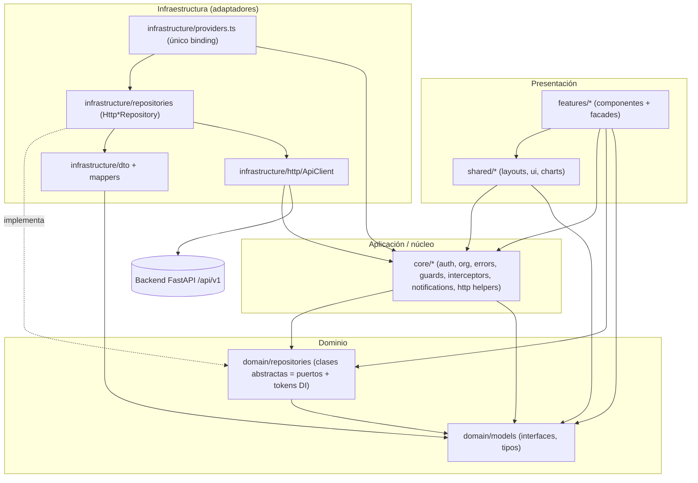

# Arquitectura del frontend LoGyCO₂

> Leyenda: **[V]** verificado leyendo el código · **[?]** no comprobado (inferido o fuera del alcance leído).
> Ruta base de todos los paths: `logyco2-frontend/`. Documentos hermanos: [core.md](core.md), [domain-infrastructure.md](domain-infrastructure.md), [shared.md](shared.md), [tooling.md](tooling.md), `features/*.md`.

## Resumen

- SPA Angular 20 (standalone components, signals, control flow `@if/@for/@switch`, sin NgModules) con TypeScript 5.9 estricto. [V]
- Plataforma de huella de carbono de LOGYCA. Habla con un backend FastAPI (`/api/v1`) y expone dos contextos: **espacio de organización** (`/`) y **consola de plataforma** (`/plataforma`, solo rol global `SUPER_ADMIN`). [V]
- Arquitectura por capas con inversión de dependencias estilo hexagonal: la UI usa **facades** (en `features/`) → **puertos** (clases abstractas en `domain/repositories`) → **adaptadores** (`infrastructure/repositories`, HTTP). El enlace puerto↔adaptador vive en un único archivo: `src/app/infrastructure/providers.ts`. [V]
- Solo la identidad/organizaciones/usuarios/invitaciones/superadmins/RBAC/métricas/salud/Intelligence/guía de cálculo de emisiones (`emissions`: vehículos, factor del diésel B2 y simulación) y el inventario de vehículos de la empresa (`vehicles`) y las cargas de Excel (`imports`) tienen backend real, y solo eso tiene pantalla. Los módulos sin backend (operaciones, cargas, conciliación, evidencias, emisiones, reportes, reducción y varias secciones de la consola) **no tienen pantalla, facade, puerto ni datos**: su ruta renderiza `ComingSoonComponent` ("Próximamente") y su ítem de menú lleva `soon: true`. [V]
- Estado: señales (`signal`, `computed`, `effect`) en servicios `providedIn: 'root'`; nada de NgRx. El recurso asíncrono estándar es `ScopedResource<T>`. Todo estado dependiente de la organización se registra en `ContextResetRegistry` para descartarlo al cambiar de organización o cerrar sesión. [V]
- Autenticación: Bearer token en memoria (`SessionStore`); persistencia opcional en `sessionStorage` solo en desarrollo (`sessionPersistence: 'tab'`). RBAC en cliente (`AccessPolicy`) es solo para mostrar/ocultar; el backend autoriza. [V]
- Errores: un único punto (`errorInterceptor` + `toAppError`) convierte todo en `AppError` con mensaje del catálogo en español; nunca se muestra el texto crudo del servidor. [V]
- Sin NgRx, sin Angular Material/CDK, sin librería de gráficos: gráficos SVG propios. Estilos: `src/styles.scss` (tokens CSS) + estilos inline por componente. [V]

## Tabla de contenidos

1. [Versiones y librerías clave](#1-versiones-y-librerías-clave)
2. [Mapa de carpetas](#2-mapa-de-carpetas)
3. [Capas y dependencias (diagrama)](#3-capas-y-dependencias)
4. [Bootstrap de la aplicación](#4-bootstrap-de-la-aplicación)
5. [Routing](#5-routing)
6. [Estado](#6-estado)
7. [Manejo de errores](#7-manejo-de-errores)
8. [Autenticación y autorización](#8-autenticación-y-autorización)
9. [Convenciones de nombres](#9-convenciones-de-nombres)
10. [Mapeo a SOLID / hexagonal / atomic / container-presentational](#10-mapeo-a-principios)
11. [Hallazgos de calidad](#11-hallazgos-de-calidad)
12. [Cómo extender](#12-cómo-extender)

---

## 1. Versiones y librerías clave

| Pieza | Versión (package.json) | Notas |
|---|---|---|
| Angular (`core/common/compiler/forms/platform-browser/router`) | `^20.3.0` | [V] standalone, signals, `@angular/build:application` |
| `@angular/cli`, `@angular/build` | `^20.3.43` | builder `application` (esbuild/Vite) [V] |
| TypeScript | `~5.9.2` | `strict`, `noImplicitOverride`, `noPropertyAccessFromIndexSignature`, `noImplicitReturns` [V] |
| RxJS | `~7.8.0` | solo en capa de datos y facades; la UI lee señales [V] |
| zone.js | `~0.15.0` | **sigue usando Zone** (`provideZoneChangeDetection({ eventCoalescing: true })`) [V] |
| Test | Karma `~6.4`, Jasmine `~5.9`, `karma-chrome-launcher`, `karma-coverage` | builder `@angular/build:karma` [V] |
| Lint | `eslint ^9.39`, `angular-eslint 20.7.0`, `typescript-eslint 8.46.4` | flat config `eslint.config.js` [V] |

No hay dependencias de UI/estado/gráficos de terceros (ver [tooling.md](tooling.md)). [V]

## 2. Mapa de carpetas

```
src/
  main.ts                      bootstrapApplication(App, appConfig)
  index.html                   <app-root>, lang="es", theme-color
  styles.scss                  tokens CSS + clases base (.btn, .card, .badge, .alert, .table-wrap, ...)
  environments/                environment.ts (GENERADO por scripts/generate-env.mjs desde .env o el entorno; no se versiona)
  testing/                     providers.ts (provideTestApp), builders.ts (buildUser, ORG_*, FAKE_TOKEN)
  app/
    app.ts                     App: <router-outlet/> + <app-toast-host/> + <app-confirm-dialog-host/> + <app-action-feedback-host/> (instancia ThemeService)
    app.config.ts              providers globales
    app.routes.ts              rutas (todas lazy)
    core/                      "aplicación": sesión, org activa, errores, guards, interceptors, notificaciones, preferencias (tema)
    domain/                    modelos (interfaces) y puertos (clases abstractas) — sin imports fuera de domain [V]
    infrastructure/            adaptadores HTTP (dto + mappers + repos + ApiClient), providers.ts
    shared/                    UI reutilizable: layouts/, ui/, ui/charts/
    features/                  pantallas + facades por módulo (documentado en docs/features/)
public/                        brand/ (logos SVG/PNG/WEBP), fonts/ (Museo Sans .otf; también quedan los archivos de Inter), favicon.svg
```

## 3. Capas y dependencias



Reglas de dependencia observadas [V por grep de imports]:

| Regla | Estado |
|---|---|
| `domain/**` no importa nada de `core`, `infrastructure`, `shared`, `features` | Cumple (0 imports) |
| `core/**` no importa de `features`, `infrastructure` ni `shared` | Cumple (0 imports; solo usa `domain`) |
| `infrastructure/**` importa de `core` únicamente: `config/app-config` y `http/api-envelope` | Cumple, con matiz: `infrastructure → core` (el "núcleo" actúa como shared-kernel) |
| `shared/**` importa de `core` y `domain`; además `shared/layouts/shell.component.ts` importa de `features` (`HomeFacade` y `OrganizationLogoStore`) | Desvío de la regla `shared` ← `features` [V]; los layouts son "smart" (ver hallazgos) |
| Los componentes no usan `HttpClient` ni URLs (README) | [V] `HttpClient` solo se inyecta en `ApiClient` (`infrastructure/http/api-client.ts`); `app.config.ts` solo llama `provideHttpClient`; `http-error-mapper` usa solo el tipo `HttpErrorResponse`. Ningún `@Directive`/`@Pipe` propio |
| No hay regla ESLint que haga cumplir los límites de capa | **Gap**, ver hallazgo H-A3 |

Flujo típico de una lectura real (ejemplo organizaciones):
`CompanyProfileComponent` → `HomeFacade.load()` → `OrganizationsRepository.get(id)` (token DI abstracto) → `HttpOrganizationsRepository` → `ApiClient.get('/organizations/{id}')` → `authInterceptor` (Bearer) → red → `errorInterceptor` → `toOrganization` → `ScopedResource.data` (señal) → plantilla.

## 4. Bootstrap de la aplicación

`src/main.ts`: `bootstrapApplication(App, appConfig).catch(console.error)`. [V]

`src/app/app.config.ts` (`appConfig: ApplicationConfig`), providers en orden: [V]

| # | Provider | Efecto |
|---|---|---|
| 1 | `provideBrowserGlobalErrorListeners()` | captura errores globales del navegador |
| 2 | `provideZoneChangeDetection({ eventCoalescing: true })` | change detection con Zone |
| 3 | `provideRouter(routes, withComponentInputBinding())` | los parámetros de ruta/query se enlazan a `input()` de los componentes |
| 4 | `provideHttpClient(withInterceptors([authInterceptor, errorInterceptor]))` | orden: primero adjunta el token, luego interpreta errores |
| 5 | `{ provide: LOCALE_ID, useValue: 'es-CO' }` + `registerLocaleData(localeEsCo)` | pipes de fecha/número en es-CO |
| 6 | `{ provide: IMAGE_CONFIG, useValue: { disableImageSizeWarning: true, disableImageLazyLoadWarning: true } }` | silencia avisos de `NgOptimizedImage` (logo sin reescalar) |
| 7 | `{ provide: APP_CONFIG, useValue: environment }` | configuración por entorno (`AppConfig`) |
| 8 | `provideRepositories()` | binding puertos → adaptadores (`infrastructure/providers.ts`) |
| 9 | `provideAppInitializer(() => inject(SessionPersistence).restore())` | antes de la primera navegación restaura/revalida sesión si `sessionPersistence === 'tab'` (timeout 5 s) |

Componente raíz `App` (`src/app/app.ts`, selector `app-root`, OnPush): `<router-outlet />`, `<app-toast-host />`, `<app-confirm-dialog-host />` y `<app-action-feedback-host />` (los tres hosts globales renderizan `ToastService`, `ConfirmService` y `ActionFeedbackService`); inyecta `ThemeService` para aplicar el tema guardado desde el primer render. [V]

`index.html`: `lang="es"`, `<base href="/">`, `theme-color #51534a`, favicon SVG, sin CSP meta. [V]

## 5. Routing

Todo `loadComponent` es lazy; solo `ShellComponent`, `PLATFORM_ROUTES` y los guards se importan estáticamente. `withComponentInputBinding` activo. Breadcrumbs vía `data: { breadcrumb }` (ver `buildCrumbs` en [shared.md](shared.md)). [V]

### Rutas raíz (`src/app/app.routes.ts`)

| Ruta | Guards | Carga | Componente |
|---|---|---|---|
| `/login` | `canActivate: guestGuard` (si ya hay sesión → `LandingPolicy.home()`) | lazy | `features/auth/login.component` → `LoginComponent` |
| `/activar` | — (pública: el código del correo va en el fragmento) | lazy | `ActivateAccountComponent` |
| `/aceptar-invitacion` | `canActivate: tokenGuard` (exige token, no usuario) | lazy | `AcceptInvitationComponent` |
| `/acceso-pendiente` | `canActivate: authGuard` | lazy | `PendingAccessComponent` (`features/system/system-pages.component`) |
| `/plataforma` | `canMatch: platformMatch` · `canActivate: [authGuard, platformGuard]` | lazy (`PlatformShellComponent`) + hijos `PLATFORM_ROUTES` | consola global |
| `''` (shell) | `canActivate: authGuard` | `ShellComponent` (eager) con hijos | espacio de organización |

### Hijos del shell de organización

| Ruta | Permiso (`permissionGuard`, cualquiera de la lista) | Breadcrumb | Componente (lazy) |
|---|---|---|---|
| `''` | `homeGuard` | — | redirige a `LandingPolicy.home()` (`pathMatch: full`) |
| `inicio` | — | — | `redirectTo: 'resumen'` |
| `resumen` | `workspaceGuard` (exige una membresía) | Resumen | `DashboardComponent` |
| `mi-empresa` | `organizations:read` | Datos de mi empresa | `CompanyProfileComponent` |
| `organizaciones`, `organizaciones/:id` | — | — | `redirectTo: 'mi-empresa'` (enlaces anteriores) |
| `usuarios` | `users:read` ó `memberships:manage` | Usuarios y accesos | `UsersComponent` |
| `operaciones` | `indicators:read` | Cargas y transportes | `ComingSoonComponent` («Operaciones de transporte»); `operaciones/:id` redirige a `operaciones` |
| `vehiculos` | `vehicles:read` | Mis vehículos | `VehiclesComponent` (feature `vehicles`; `wide`) |
| `cargas` | `imports:create` | Cargar información | `ImportsComponent` (feature `imports`; `wide`) |
| `conciliacion` | `indicators:read` | Conciliación | `ComingSoonComponent` («Conciliación y calidad de datos») |
| `calidad` | `indicators:read` | Calidad de datos | `ComingSoonComponent` («Calidad de datos») |
| `analisis` | `indicators:read` | Análisis de emisiones | `ComingSoonComponent` («Análisis de emisiones») |
| `ayuda` | — | Ayuda y soporte | `ComingSoonComponent` («Ayuda y soporte») |
| `evidencias` | `indicators:read` | Evidencias | `ComingSoonComponent` («Evidencias y trazabilidad») |
| `emisiones` | `indicators:read` | Emisiones | `ComingSoonComponent` («Emisiones») |
| `reportes` | `reports:read` | Reportes | `ComingSoonComponent` («Reportes y versiones») |
| `reduccion` | `indicators:read` | Planes de reducción | `ComingSoonComponent` («Planes de reducción») |
| `intelligence` | `sector_reports:read` | LoGyCO₂ Intelligence | `IntelligenceComponent` |
| `configuracion` | — | Configuración | `SettingsComponent` |
| `acceso-denegado` | — | Acceso denegado | `ForbiddenComponent` (`features/system/system-pages.component`) |
| `**` | — | No encontrada | `NotFoundComponent` |

### Hijos de `/plataforma` (`src/app/features/platform/platform.routes.ts`, `PLATFORM_ROUTES`)

`''`→redirect `resumen`; `resumen`; `organizaciones` (+`:id`); `usuarios` (+`:id`); `metricas`→redirect `resumen`; `configuracion`; `estado`; `superadministradores` (+`:id`); `roles` (+`matriz`); `auditoria`; `calculo-emisiones` (`EmissionsComponent`, ver [features/emissions.md](features/emissions.md)); `metodologias`→redirect `calculo-emisiones`; `intelligence/{energia,costos,fuentes}`; `vehiculos`, `operaciones`, `cargas`, `calidad` y `reportes` (estas cinco renderizan `ComingSoonComponent`, ver [features/system.md](features/system.md)); `**`→redirect `resumen`. Todos lazy con `data.breadcrumb`. No llevan guard propio: dependen del guard del padre `/plataforma`. [V]

### Guards (detalle en [core.md](core.md))

- `authGuard`: sesión completa → true; solo token → `/aceptar-invitacion`; nada → `/login?returnUrl=<url>`.
- `platformMatch` (`CanMatchFn`, síncrono): evita descargar el chunk a quien ya se sabe sin rol global; sin sesión deja pasar.
- `platformGuard` (`CanActivateFn`, asíncrono): `refreshUser()` (`GET /auth/me` fresco); cualquier fallo → `/acceso-denegado`.
- `permissionGuard(...codes)`: fábrica; usa `AccessPolicy.canAny`; falla → `/acceso-denegado`.
- `guestGuard`: con sesión completa redirige a `LandingPolicy.home()`. `homeGuard` y `workspaceGuard` (`core/guards/landing.guards.ts`) deciden el aterrizaje con `LandingPolicy` (`/plataforma/resumen` para superadministradores; `/resumen` con membresía; `/acceso-pendiente` sin ella).
- `tokenGuard`: exige token aunque no haya usuario (solo `/aceptar-invitacion`).

Observación: `/acceso-denegado` solo existe bajo el shell de organización; un usuario denegado en `/plataforma` aterriza allí. [V]

## 6. Estado

| Mecanismo | Dónde | Para qué |
|---|---|---|
| `signal`/`computed` en servicios root | `SessionStore`, `OrganizationContext`, `AccessPolicy`, `PlatformAccess`, `LandingPolicy`, `ThemeService`, `ToastService`, `ConfirmService`, `ActionFeedbackService` | estado global de sesión/contexto/UX |
| `ScopedResource<T>` (`status`, `data`, `error`, `load()`, `reset()`) | facades de `features/*` | recurso asíncrono con descarte de respuestas tardías (contador de generación) |
| `ContextResetRegistry` | `core/org/context-reset.ts` | `track(resource)` en facades; `resetAll()` al cambiar de organización y al cerrar sesión |
| `reloadOnContextChange(load)` | componentes (constructor) | `effect` que recarga al cambiar la organización activa |
| `sessionStorage` `logyco2.session` | `SessionPersistence` | solo token, solo si `sessionPersistence==='tab'` |

Sin store global tipo NgRx; sin caché HTTP; los datos se piden de nuevo en cada carga. [V]

## 7. Manejo de errores

1. Backend devuelve `{ error: { code, message?, details?, request_id? } }` (`ErrorResponseDto`).
2. `errorInterceptor` → `toAppError(error)` → `AppError(kind, code, status, message, requestId, details, retryAfterSeconds)`. El `message` sale de `ERROR_MESSAGES[code]` → `STATUS_FALLBACKS[status]` → genérico. El texto del servidor **nunca** se muestra. [V]
3. Efectos laterales del interceptor: `401` con sesión activa → `SessionExpiryHandler.handle()` (limpia sesión y va a `/login?reason=expired&returnUrl=`); `403` con código `ORGANIZATION_ACCESS_DENIED|ORGANIZATION_INACTIVE` y URL `/organizations/<uuid>` → `OrganizationContext.markAccessLost(id)` (el shell muestra aviso). [V]
4. `ScopedResource.load` aplica `toAppError` también a errores no-HTTP. `ResourceStateComponent` pinta `loading | error (con requestId y "Reintentar") | empty | ready`. [V]
5. Feedback transitorio: `ToastService` (`success/info/warning/error`, TTL 4/5/6/8 s), confirmaciones `ConfirmService.confirm()` (promesa) y `ActionFeedbackService` (aviso `working`/`done` de las acciones). [V]

## 8. Autenticación y autorización

- Login: `POST /auth/login` → `{access_token, token_type, expiration_time_utc_bogota}`; luego `GET /auth/me` carga usuario y membresías. Sin refresh token ni cookie HttpOnly; el cierre de sesión **no revoca** el token en el servidor. [V (README + código)]
- Sesión en memoria (`SessionStore`). Persistencia por entorno (`AppConfig.sessionPersistence`): dev `tab` (sessionStorage, revalidada con `/auth/me`, timeout 5 s), prod `memory`. [V]
- `authInterceptor` adjunta `Authorization: Bearer …` **solo** si la URL empieza por `apiBaseUrl + apiPrefix`. [V]
- Identidad válida sin usuario local (`USER_NOT_REGISTERED`): `AuthFacade.pendingRegistration=true`; el token se conserva solo para aceptar invitación (`/aceptar-invitacion`). [V]
- Autorización de interfaz: `AccessPolicy` espeja la matriz rol→permiso del backend (`GLOBAL_ROLE_PERMISSIONS`, `ORGANIZATION_ROLE_PERMISSIONS`); `/auth/me` solo devuelve roles. Solo oculta menús y bloquea navegación; el backend decide (403/404). [V]
- Rol global: `hasSuperAdminRole(user)` = usuario activo con `global_roles` que contenga `SUPER_ADMIN`; confirmado con consulta fresca en `platformGuard`. `ORG_ADMIN` nunca da acceso global. [V]

## 9. Convenciones de nombres

| Elemento | Convención | Ejemplos [V] |
|---|---|---|
| Archivos de componente | `<nombre>.component.ts` (standalone, template inline) | `shell.component.ts`, `pagination.component.ts` |
| Selector | prefijo `app-`, kebab-case (regla ESLint) | `app-resource-state`, `app-status-badge` |
| Directivas (si existieran) | prefijo `app`, camelCase | regla ESLint; no hay directivas propias [V] |
| Clase raíz | `App` (no `AppComponent`) | `app.ts` |
| Facades | `<feature>.facade.ts`, `XxxFacade` (`providedIn: 'root'`) | `LinksFacade`, `AuthFacade` (en `core`) |
| Puertos | clase abstracta `XxxRepository` en `domain/repositories/*.repositories.ts` | `AuthRepository` |
| Adaptadores HTTP | `HttpXxxRepository` en `infrastructure/repositories/http-*.ts` | `HttpAuthRepository` |
| DTO | `XxxDto`, propiedades `snake_case` (forma del backend) | `MeResponseDto` |
| Mappers | funciones `toXxx(dto)` | `toCurrentUser` |
| Modelos de dominio | interfaces `readonly`, `camelCase` | `CurrentUser` |
| Guards | `xxxGuard` / `xxxMatch` (funcionales) | `authGuard`, `platformMatch` |
| Interceptors | `xxxInterceptor` (funcionales) | `authInterceptor` |
| Tests | `*.spec.ts` junto al archivo | `auth.facade.spec.ts` |
| Idioma | UI y comentarios en español; rutas de URL en español (`/organizaciones`); identificadores en inglés | `/conciliacion` |
| Constantes | `UPPER_SNAKE` | `ERROR_MESSAGES`, `NAV_ITEMS` |
| Señales | sin sufijo `$`; observables sin sufijo en repos | `status`, `data` |

Estilo de código: comillas simples, 2 espacios, `printWidth: 100` (config `prettier` en `package.json`, aunque `prettier` no está instalado, ver [tooling.md](tooling.md)). `ChangeDetectionStrategy.OnPush` en TODOS los componentes de `src/app` (verificado por grep). `inject()` en vez de constructor DI. [V]

## 10. Mapeo a principios

| Principio | Cómo se materializa | Dónde | Evaluación |
|---|---|---|---|
| **S** (SRP) | Un servicio = una responsabilidad: `SessionStore` (estado), `SessionPersistence` (almacenamiento), `SessionExpiryHandler` (reacción a 401), `AccessPolicy` (permisos), `PlatformAccess` (hint de rol global), `ToastService`/`ConfirmService` | `core/` | Bien. Excepción: `ShellComponent` con ~60 líneas de CSS inline y varias responsabilidades (layout + nav + avisos) |
| **O** (OCP) | Añadir un módulo = nuevo puerto + adaptador HTTP + una línea en `providers.ts`; añadir un mensaje de error = una entrada en `ERROR_MESSAGES` | `providers.ts`, `error-catalog.ts` | Bien. `providers.ts` es la única edición obligatoria y crece linealmente |
| **L** (LSP) | Cada `Http*Repository` extiende su clase abstracta y la sustituye sin que la facade lo note | `infrastructure/` | Bien |
| **I** (ISP) | Puertos pequeños por agregado (`AuthRepository`, `UsersRepository`, `InvitationsRepository`, `MembershipsRepository`, …) | `domain/repositories` | Bien; algunos puertos son anchos (`OrganizationAdminRepository` 6 métodos) pero cohesivos |
| **D** (DIP) | Facades y `AuthFacade` dependen de clases abstractas (token DI); el binding concreto solo en `providers.ts`; `APP_CONFIG` `InjectionToken` | todo el proyecto | Muy bien |
| **Hexagonal** | Dominio = centro (sin imports salientes); puertos = clases abstractas; adaptadores = HTTP; "actores primarios" = componentes/facades | `domain/`, `infrastructure/` | Bien; el "núcleo" `core/` mezcla servicios de aplicación y shared-kernel (config, errores, sesión) |
| **Screaming** | La raíz de `features/` grita el negocio (`organizations`, `users`, `platform`, `intelligence`, …) pero `core/` y `shared/` son carpetas técnicas | `features/` | Aceptable |
| **Atomic design** | No aplicado como tal: `shared/ui` mezcla átomos (`StatusBadge`), moléculas (`Pagination`, `ResourceState`) y organismos (`Shell`, `ToastHost`); no hay carpetas atoms/molecules/organisms | `shared/` | Informal |
| **Container/Presentational** | Contenedores = componentes de `features/*` + facades; presentacionales = `shared/ui/*` con `input()`/`output()` y OnPush (`Pagination`, `StatusBadge`, `ResourceState`, charts). Los layouts (`UserMenu`, `Shell`) son contenedores (inyectan servicios de `core`) | `shared/` | Bien en `ui/`; mixto en `layouts/` |
| **Clean Code** | Comentarios explican el *porqué* (seguridad, decisiones); funciones pequeñas y puras (`toAppError`, `axisFor`, mappers) | transversal | Bien |

## 11. Hallazgos de calidad

Formato: severidad · archivo · problema · sugerencia. Detalle por capa en cada documento hermano.

| ID | Sev. | Ubicación | Hallazgo | Sugerencia |
|---|---|---|---|---|
| H-A1 | Alta | `src/app/core/auth/session-persistence.ts`, `src/environments/environment.ts` | Con `sessionPersistence: 'tab'` el token Bearer vive en `sessionStorage` (legible por cualquier XSS). Está documentado y acotado a desarrollo; producción usa `memory`. El logout no revoca el token (no hay endpoint). | Mantener `memory` en prod; priorizar cookie HttpOnly + `/auth/refresh` + `/auth/logout` (contrato en README). Añadir una prueba/guard de build que falle si `production && sessionPersistence==='tab'` |
| H-A2 | Media | `src/app/core/auth/access-policy.ts` | La matriz rol→permiso duplica la del backend (riesgo de deriva silenciosa). Solo afecta UX, no seguridad. | Que `/auth/me` devuelva permisos efectivos (ya recomendado en README) y eliminar el espejo |
| H-A3 | Media | `eslint.config.js` | Sin reglas que hagan cumplir las dependencias entre capas (p. ej. `domain` no importa `infrastructure`); hoy se cumple solo por disciplina. | `no-restricted-imports` por glob de carpeta o `eslint-plugin-boundaries`/`@nx/enforce-module-boundaries` |
| H-A4 | Baja | `src/app/app.config.ts` | Zone.js sigue activo con componentes OnPush + signals; Angular 20 permite `provideZonelessChangeDetection()`. | Evaluar migración a zoneless (quitar `zone.js` de `polyfills` en `angular.json`) |
| H-A5 | Baja | `src/index.html` | Sin Content-Security-Policy (ni meta ni se ve cabecera). | Definir CSP en el servidor/hosting (importante mientras el token pueda estar en `sessionStorage`) [?] cabeceras reales no comprobadas |
| H-A6 | Baja | repo | Según `CLAUDE.md` el repositorio aún no tiene commits (no se ejecutó `git` al documentar [?]). | Hacer un primer commit para tener línea base |
| H-A7 | Baja | `src/app/app.routes.ts` | `/acceso-denegado` y `**` están dentro del shell de organización; un fallo de guard en `/plataforma` redirige al shell de organización y muestra su navegación. | Aceptable; si se quiere separar contextos, añadir rutas de error bajo `/plataforma` |
| H-A8 | Info | tests | 934 specs ejecutadas (carpetas `features`, `infrastructure`, `shared` y `core`). Cobertura de `core` buena (guards, interceptors, sesión, mapper de errores); `shared/` logo, resource-state, shell, navegación, charts, pager, paginación por cursor, org-logo, close-on-backdrop; sin e2e. | Añadir specs a `pagination`, `confirm-dialog-host`, `toast-host`, `user-menu` |

## 12. Cómo extender

**Nuevo módulo de negocio con backend real**
1. `domain/models/<x>.ts`: interfaces `readonly` (camelCase).
2. `domain/repositories/<x>.repositories.ts`: `export abstract class XRepository { abstract list(...): Observable<...>; }`.
3. `infrastructure/dto/<x>.dto.ts` (snake_case) y `infrastructure/mappers/<x>.mappers.ts` (`toX`).
4. `infrastructure/repositories/http-<x>.repository.ts`: `@Injectable() class HttpXRepository extends XRepository` usando `ApiClient`.
5. `infrastructure/providers.ts`: `{ provide: XRepository, useClass: HttpXRepository }`.
6. `features/<x>/<x>.facade.ts` (`providedIn: 'root'`, `ScopedResource` registrado con `ContextResetRegistry.track`) y `<x>.component.ts` (OnPush, `reloadOnContextChange`).
7. Ruta en `app.routes.ts` con `data.breadcrumb` y `canActivate: [permissionGuard('...')]`; entrada en `shared/layouts/nav-items.ts`.
8. Mensajes de error nuevos en `core/errors/error-catalog.ts`.

**Módulo sin backend aún**: no se crea pantalla, facade, puerto, modelo ni datos de ejemplo. Basta una ruta que cargue `ComingSoonComponent` (`features/system/coming-soon.component.ts`) con `data: { breadcrumb, title, description }` en `app.routes.ts` (o `platform.routes.ts`) y, si debe verse en el menú, un ítem de `shared/layouts/nav-items.ts` con `soon: true` (se atenúa y muestra la etiqueta «Próximamente»). Cuando exista la API se sigue la receta anterior y se reemplaza la ruta por la pantalla real (`soon: false`).

**Nuevo permiso**: añadir el código a `PERMISSION_CODES` (`domain/models/identity.ts`) y a las matrices de `access-policy.ts`.

**Nueva variable de entorno**: ampliar `AppConfig` (`core/config/app-config.ts`), `scripts/generate-env.mjs` y `.env.example`.

**Tests**: usar `provideTestApp()` (repositorios HTTP reales con `HttpClient` simulado) y `buildUser()/signInAs()` de `src/testing/`.
